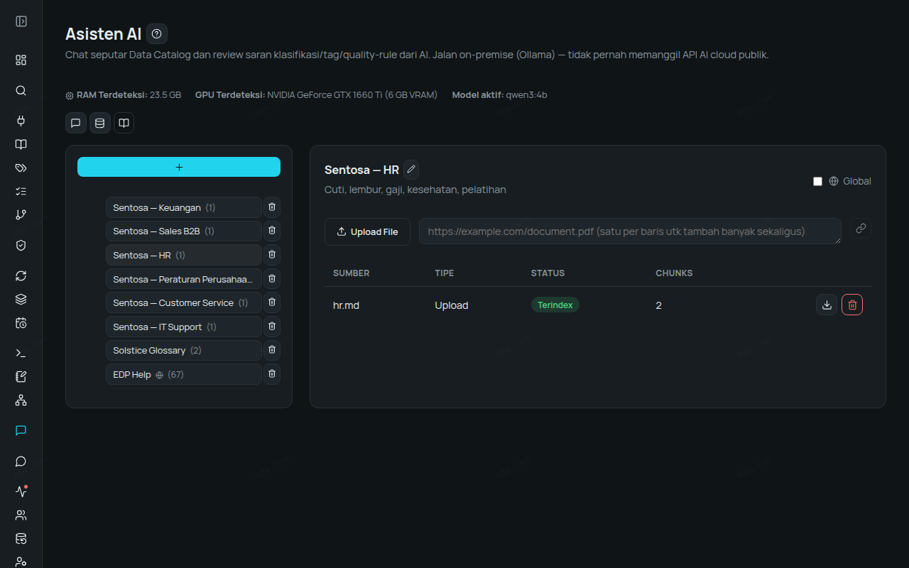
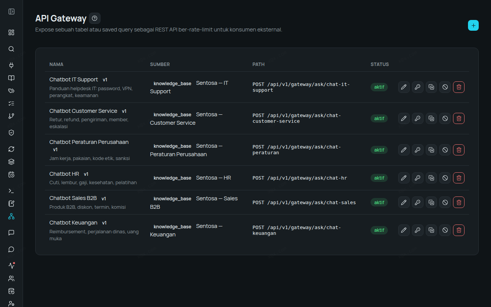
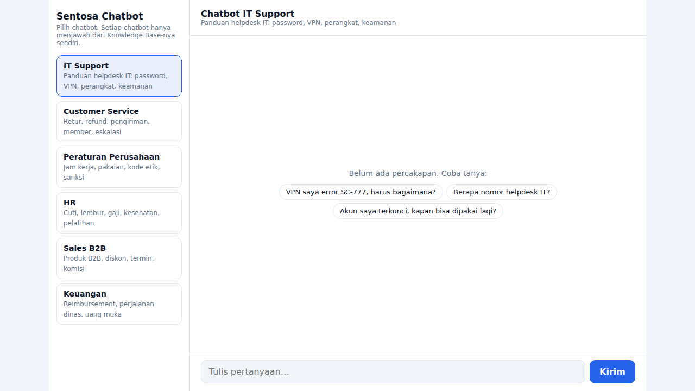
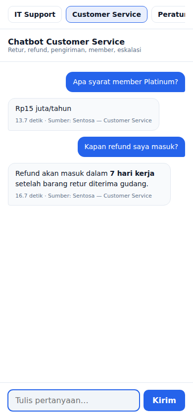
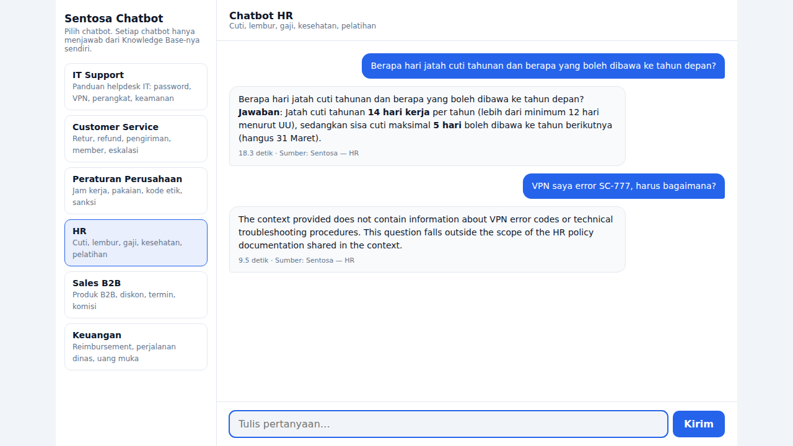
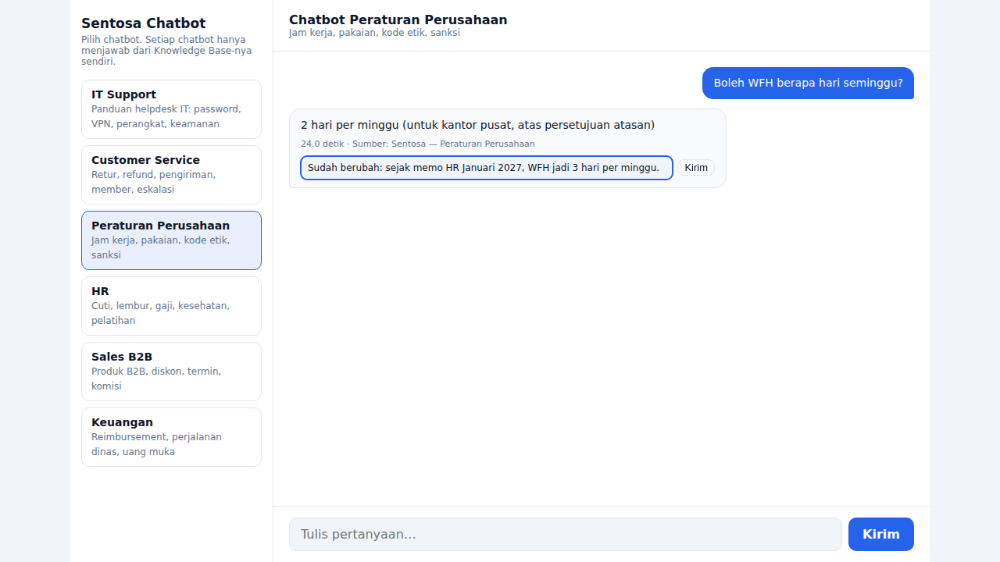
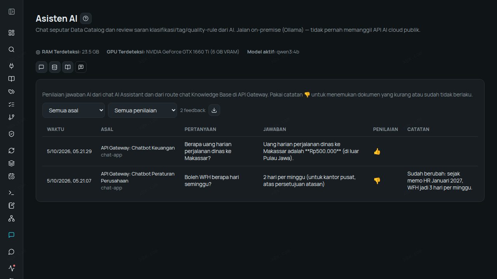
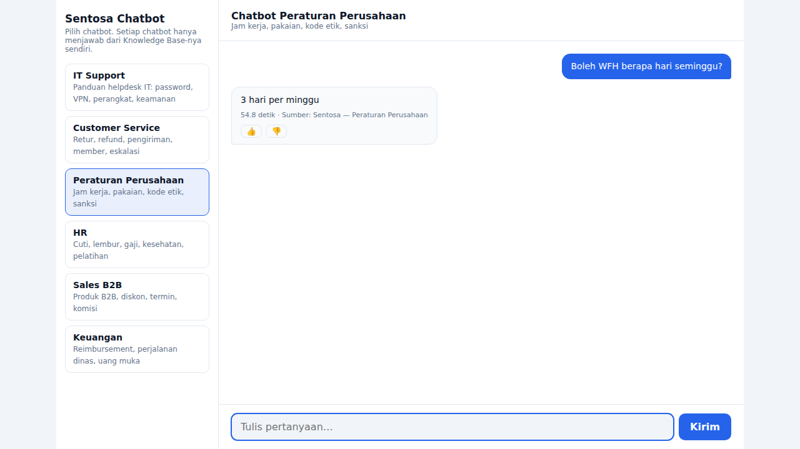
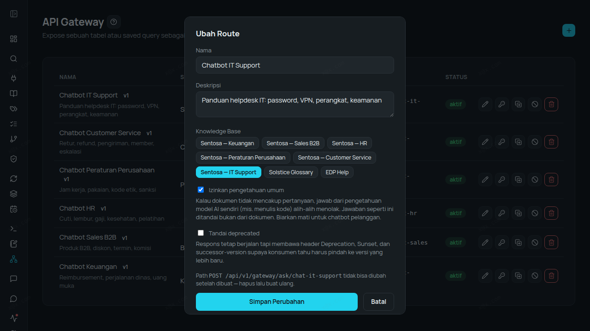
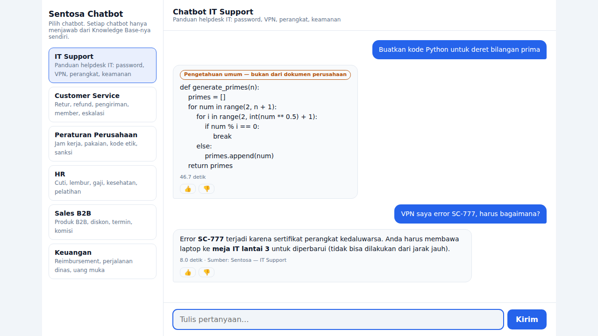

# Walkthrough — One Platform, Six Company Chatbots (IT Support, Customer Service, Company Rules, HR, Sales, Finance)

**Language:** [Bahasa Indonesia](README.md) · English

The easy way to build custom company chatbots with Enterprise Data Platform: upload internal
documents to a **Knowledge Base**, publish it as a **chat API** through the **API Gateway**, then put a
simple chat page in front of it. Each chatbot answers only from its own documents, and all AI runs
**on-premise** (Ollama `qwen3:4b`, 6 GB consumer GPU). No document or question is sent to a public AI
service.

Every answer and response time below comes from a real run, not a made-up example.

> The fictional company, its documents, the chat UI, and the questions are in Indonesian. Questions
> and answers below are translated into English, with the original meaning kept exactly.

## Scenario

**PT Sentosa Retail Group** (fictional) wants employees and customers to stop asking the same things
over and over in private chats. Every department has its own guideline document:

| Chatbot | Document | Example contents |
|---|---|---|
| IT Support | `kb/it-support.md` | helpdesk ext. 4357, VPN error codes SC-401/503/777 |
| Customer Service | `kb/customer-service.md` | 14-day returns, refunds in 7 working days, Platinum membership |
| Company Rules | `kb/peraturan-perusahaan.md` | WFH 2 days/week, supplier gifts max. Rp500,000, warning letters SP1–SP3 |
| HR | `kb/hr.md` | 14 days annual leave, 5-day carry-over, 5 days paternity leave |
| B2B Sales | `kb/sales.md` | discount approval matrix, 2% commission |
| Finance | `kb/keuangan.md` | per diem outside Java Rp500,000, cash advances settled in 7 working days |

Every number and term in the documents (SentosaConnect, SC-777, ext. 4357, etc.) is **made up** — an
AI model cannot know them from general knowledge. If the answer is right, it read your documents.

## Step 1 — Create One Knowledge Base per Department (±1 minute per KB)

1. Open **AI Assistant → Knowledge Base → New Knowledge Base**, name it e.g. `Sentosa — HR`.
2. Upload the document (PDF, Word, Markdown, text, or add from a URL).
3. Wait until the document status is **indexed**.

Real result: 6 KBs, one document each, indexed into 2–3 chunks in **3–9 seconds** per document.



> One KB per department matters: the HR chatbot must not answer from Finance documents, and vice
> versa. A KB can also hold many documents.

## Step 2 — Publish Each KB as a Chat API

1. Open **API Gateway → + New Route**.
2. Source: **Knowledge Base**, pick the KB (e.g. `Sentosa — HR`), path `chat-hr`.
3. Click **Generate Key**. The API key is shown only once — store it safely.
4. Repeat for the other 5 KBs (`chat-it-support`, `chat-customer-service`, `chat-peraturan`,
   `chat-sales`, `chat-keuangan`).

Each route has its own API key and its own rate limit, and can be revoked at any time without
affecting the other chatbots. Every question is recorded in the **Audit Log**.



How to call it from any application:

```bash
curl -X POST https://<your-gateway-domain>/api/v1/gateway/ask/chat-hr \
  -H "apikey: <API key>" -H "Content-Type: application/json" \
  -d '{"question": "Cuti ayah berapa hari?"}'
```

Response: `{"answer": "...", "sources": [{"label": "Sentosa — HR", ...}]}`.

## Step 3 — A Simple Chat Page (folder `chat-app/`)

Just two files, no framework and no `pip install`:

- `index.html` — chatbot list on the left, conversation on the right, example questions per chatbot,
  source documents, response time, and 👍/👎 buttons under every answer. Works on phones.
- `server.py` — a tiny server (standard-library Python) that serves the page and forwards questions
  to the API Gateway. **API keys stay on the server** and are never sent to employees' or customers'
  browsers.

```bash
cd chat-app
cp config.example.json config.json   # fill in gateway_url + one entry per chatbot (path + API key)
python3 server.py                    # then open port 8765 in a browser
```

Want a 7th chatbot (e.g. Legal)? Create a new KB + route and add one entry to `config.json`.





## Results — Real Questions and Answers

Every question goes through `chat-app` → API Gateway → Knowledge Base → on-premise AI.
Time = total until the answer appears.

**IT Support**

- *"My VPN shows error SC-777, what should I do?"* (29 seconds)
  > Error **SC-777** happens because the device certificate has expired. You need to bring your
  > laptop to the IT desk on the 3rd floor to renew it (it can't be done remotely).
- *"What is the IT helpdesk number and its service hours?"* (33 seconds)
  > The IT helpdesk number is extension **4357** (H-E-L-P), with service hours Monday–Friday
  > 07:00–20:00 and Saturday 08:00–14:00.

**Customer Service**

- *"How long is the return window, and when will my refund arrive?"* (19 seconds)
  > The return window is **14 days** from receiving the item (with a receipt or order number).
  > The refund arrives within **7 working days** after the warehouse receives the returned item.
- *"What are the requirements for Platinum membership?"* (18 seconds)
  > To become a Platinum member you must spend at least Rp15 million per year.

**Company Rules**

- *"How many days a week can I work from home?"* (21 seconds)
  > 2 days per week
- *"Can I accept a gift from a supplier?"* (36 seconds)
  > No, you may not accept supplier gifts worth more than Rp500,000. Gifts above that value must be
  > reported to the Compliance team within 3 working days.

**HR**

- *"How many days of annual leave do I get, and how many can I carry over to next year?"* (18 seconds)
  > Annual leave is **14 working days**, and at most **5 days** may be carried over to the next year.
- *"How many days is paternity leave?"* (22 seconds)
  > Paternity leave is **5 working days**.

**B2B Sales**

- *"Who has to approve a 12% discount?"* (19 seconds)
  > Head of Sales
- *"What is the sales commission and when is it paid?"* (15 seconds)
  > Sales commission is **2%** of fully paid sales value, paid together with the next month's salary.

**Finance**

- *"What is the daily allowance for a business trip to Makassar?"* (16 seconds)
  > The daily allowance for a business trip to Makassar is **Rp500,000** (outside Java).

  The document doesn't mention Makassar, only "outside Java". The AI inferred it correctly on its own.
- *"When must a work cash advance be settled?"* (29 seconds)
  > 7 working days after the activity ends

## Boundary Test — Asking the HR Chatbot About the VPN

An IT question is sent to the **HR** chatbot. The HR chatbot has no access to the IT document, so it
must refuse rather than make something up (12 seconds):



> The context provided does not contain any information about VPN error codes, technical support,
> or network-related issues. This query falls outside the scope of the HR policies and employee
> benefits documentation shared in the context. Please contact your organization's IT support team
> for assistance.

Isolation between chatbots works: no invented answer, and it points the user to the IT team.
Honest note: this refusal came out in English even though the question was in Indonesian. A small
(4B) model sometimes ignores the language instruction when the context is irrelevant; larger models
are more consistent.

## When the Rules Change — 👍/👎 Feedback

Documents go out of date. Example: a January 2027 HR memo raises WFH from 2 to 3 days, but the
document in the Knowledge Base hasn't been updated yet.

1. An employee asks the Company Rules chatbot: *"How many days a week can I work from home?"* → the
   answer is still *"2 days per week (for head office, with the manager's approval)"* (24 seconds),
   matching the old document.
2. The employee clicks 👎 and adds a note: *"This has changed: since the January 2027 HR memo, WFH is
   3 days per week."* The chat page sends it to `POST /api/v1/gateway/feedback/chat-peraturan` with
   the same API key.

   

3. The chatbot owner opens **AI Assistant → Feedback**: every rating from chat apps (and from the
   internal AI Assistant chat) in one table, filterable by 👍/👎 and exportable to CSV.

   

4. The steward replaces the document in the Knowledge Base with the revised version
   (`kb/peraturan-perusahaan-revisi-2027.md`, indexed in 2 seconds). Nothing has to change in the
   route or the chat page.
5. The same question is now answered *"3 days per week"* (55 seconds).

   

## Beyond the Documents — Asking for Python Code

By default a chatbot answers only from its documents. For internal chatbots such as IT Support, the
route owner can enable **Allow general knowledge** (API Gateway → Edit route):



- *"Write Python code for a prime number sequence"* to the **IT Support** chatbot (general knowledge
  on, 47 seconds) → a correct `generate_primes(n)` function, labelled **"General knowledge — not from
  company documents"**. The API returns `"from_general_knowledge": true`, so any application can show
  the same label.
- In the same chat, *"My VPN shows error SC-777"* is still answered from the IT document (8 seconds,
  with sources).
- The same code question to the **HR** chatbot (general knowledge off, 10 seconds) is still refused:
  > The context provided does not contain any information about Python code or prime number series
  > generation. I cannot create the requested code based on the given context.



Advice: enable it only for internal chatbots. For customer-facing chatbots, leave it off so the
chatbot doesn't answer things outside company policy.

## Response Times (Honest)

- 8–55 seconds per answer on a 6 GB consumer GPU (GTX 1660 Ti) with `qwen3:4b`; writing code takes
  about 47 seconds.
- A server GPU (e.g. L4/A10 class) cuts these times sharply, with no change on the chatbot side.
- For customer chatbots that need instant answers, turn off *Thinking* mode in **Admin → AI
  Settings** or use a bigger GPU.

## Summary

| Need | Feature |
|---|---|
| Chatbot answers from internal documents | Knowledge Base (RAG) |
| One chatbot per department, no leaks between them | 1 KB + 1 route per chatbot |
| Used by other apps (web, WhatsApp, intranet) | API Gateway: chat API + API key |
| Know who asked what | Audit Log |
| Know which answers are wrong or out of date | 👍/👎 feedback + Feedback tab |
| Internal chatbots may answer beyond the documents | Allow general knowledge option per route |
| Data never leaves the company | On-premise AI (Ollama) |

## Files

- `kb/` — six fictional PT Sentosa documents (in Indonesian), ready to upload to a Knowledge Base,
  plus `peraturan-perusahaan-revisi-2027.md` for the rule-change scenario.
- `chat-app/` — `index.html`, `server.py`, and `config.example.json` (copy it to `config.json`).

## Try It Yourself

- Free trial, no sales call: https://alzizan.co.id/register
- Want to see it with your team's use case? Request a demo, or a free in-house *Big Data & AI Tech Update* session at your office: sales@alzizan.co.id
- Demo videos: https://www.youtube.com/@AlzizanDigitalSolutions

---

The content of this repository is licensed under [CC BY 4.0](LICENSE). © PT Alzizan Digital Solutions.
